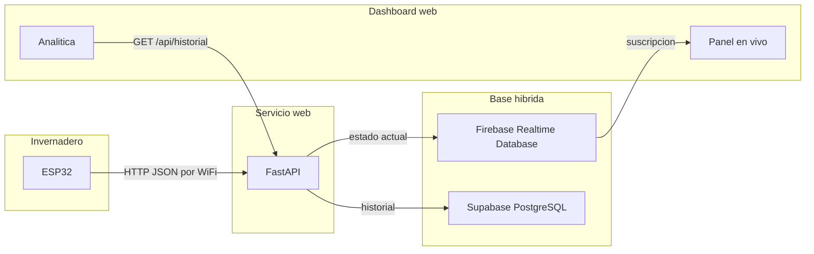
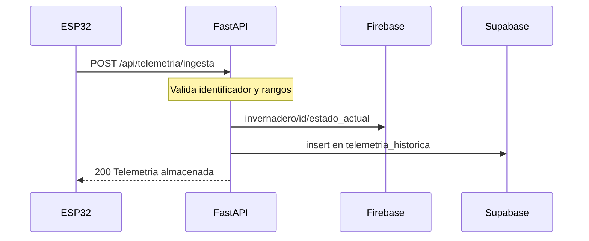
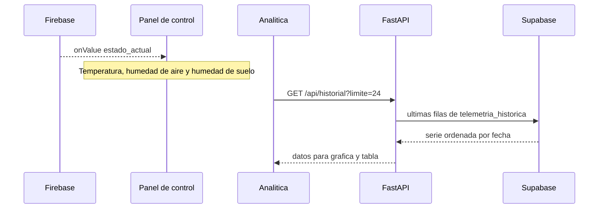

# AgroHub — Guía de exposición

Guía para presentar la arquitectura y el recorrido de la telemetría. El circuito ESP32 todavía no transmite. El flujo de software ya está definido en la API, en las dos bases de datos y en el dashboard.

Sitio de la demo: https://agrohubfront.vercel.app

---

## Cómo usar esta guía

Cada bloque tiene dos partes:

- **Mostrar:** el diagrama o el ejemplo que se proyecta.
- **Decir:** el texto para explicar ese diagrama.

Orden sugerido: apertura, arquitectura, sensor hacia backend, backend hacia frontend, cierre. Unos seis a ocho minutos.

---

## Apertura

**Decir:**

El invernadero mide temperatura, humedad del aire y humedad del suelo. Esas lecturas viajan por WiFi hasta una API. La API guarda el último valor para verlo al instante y la serie completa para ver la tendencia. El operador no consulta al ESP32: consulta el panel.

---

## 1. Arquitectura

**Mostrar:**



**Decir, de izquierda a derecha:**

- El ESP32 es el nodo de campo. Cuando el circuito esté armado, enviará un JSON por la red del invernadero.
- FastAPI es el único punto que recibe esa telemetría, la valida y decide dónde guardarla.
- Firebase guarda la fotografía actual. Sirve para el panel en vivo.
- PostgreSQL, en Supabase, guarda cada lectura. Sirve para la gráfica y la tabla histórica.
- El dashboard tiene dos caminos distintos. El panel escucha Firebase. La analítica le pide el historial a la API.

Esta estructura es la definitiva del proyecto. Cubre las cuatro capas del enunciado: captura, servicio web, base híbrida y visualización.

| Capa del enunciado | Pieza de AgroHub |
| --- | --- |
| Captura IoT | ESP32, por WiFi, con contrato HTTP |
| Servicios web | FastAPI |
| Base de datos híbrida | Firebase para el estado vivo y Supabase para el histórico |
| Visualización | Dashboard Next.js |

---

## 2. Del sensor al backend

**Mostrar:**



**Mostrar el JSON que enviará el microcontrolador:**

```json
{
  "id_dispositivo": "invernadero_01",
  "temperatura": 24.5,
  "humedad_ambiente": 65.0,
  "humedad_suelo": 45.2
}
```

**Decir en cada flecha:**

- La ruta es `POST /api/telemetria/ingesta`. La misma entrada también existe en `POST /api/telemetria`.
- La temperatura se acepta entre −10 °C y 80 °C. Las dos humedades, entre 0 % y 100 %. Si un valor sale de ese rango, la API lo rechaza y no lo guarda.
- En Firebase escribe `invernadero/invernadero_01/estado_actual` con las tres mediciones y la hora de recepción.
- En Supabase inserta una fila en `telemetria_historica`. El dispositivo tiene que existir antes en la tabla `dispositivos`, porque el historial depende de ese catálogo.
- Al ESP32 le responde:

```json
{
  "status": "ok",
  "mensaje": "Telemetria almacenada exitosamente"
}
```

---

## 3. Del backend al frontend

**Mostrar:**



**Decir:**

- El panel no le pregunta a la API cada segundo. Se suscribe a Firebase. Cuando entra una lectura nueva, la tarjeta cambia sola.
- La ruta que escucha el panel es `invernadero/{id_dispositivo}/estado_actual`.
- La analítica sí usa la API: `GET /api/historial?limite=24`. FastAPI lee PostgreSQL y devuelve las últimas filas, de la más reciente a la más antigua.
- Con eso el dashboard calcula el promedio y dibuja temperatura, humedad de aire y humedad de suelo.
- Tiempo real e histórico están separados a propósito. Uno muestra el invernadero ahora. El otro muestra cómo cambió.

---

## Cierre

**Decir:**

La plataforma ya tiene los tres tramos del dato: recepción, persistencia doble y visualización. El siguiente paso es que el ESP32 ocupe ese mismo contrato. A partir de ahí, el panel dejará de estar en espera y la analítica graficará la serie guardada en PostgreSQL.

---

## Si preguntan

**¿Por qué dos bases?**

Firebase entrega el último estado al instante. PostgreSQL conserva la relación entre dispositivo y lecturas para consultar tendencias.

**¿El dashboard habla con el sensor?**

No directamente. Habla con Firebase para el presente y con la API para el pasado.

**¿Qué se ve hoy en el sitio publicado?**

El panel está en espera porque ningún nodo está transmitiendo. La gráfica de analítica usa una serie de demostración para mostrar la vista. Los diagramas de esta guía corresponden al flujo que el código ya implementa.

**¿Y la luz y la bomba?**

Entran en el siguiente avance del contrato. Hoy la ingesta guarda las tres mediciones de estos diagramas: temperatura, humedad del aire y humedad del suelo.
